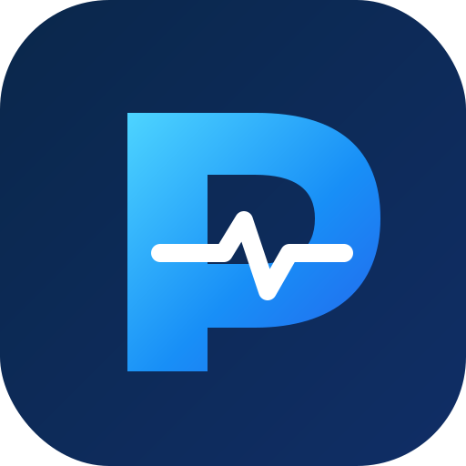
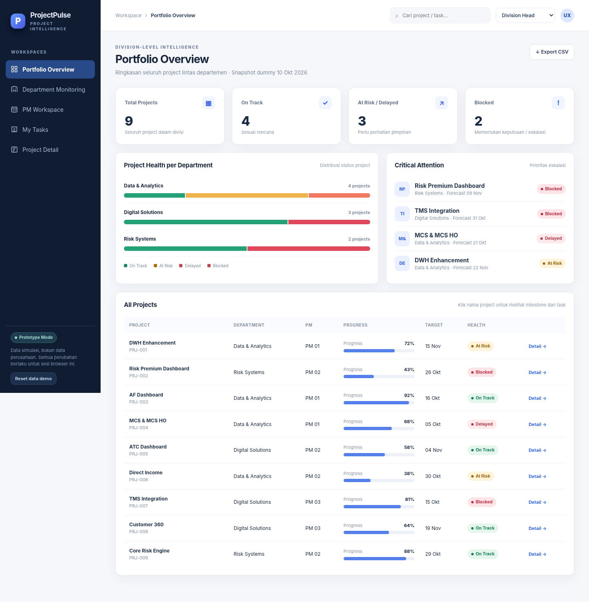
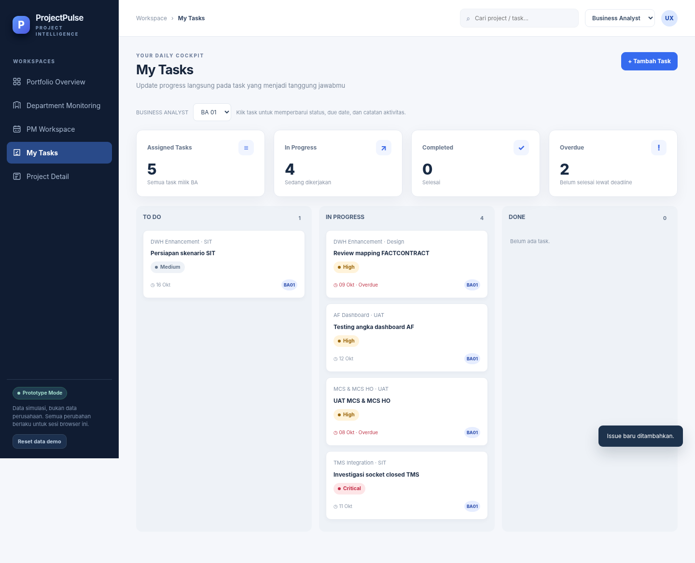
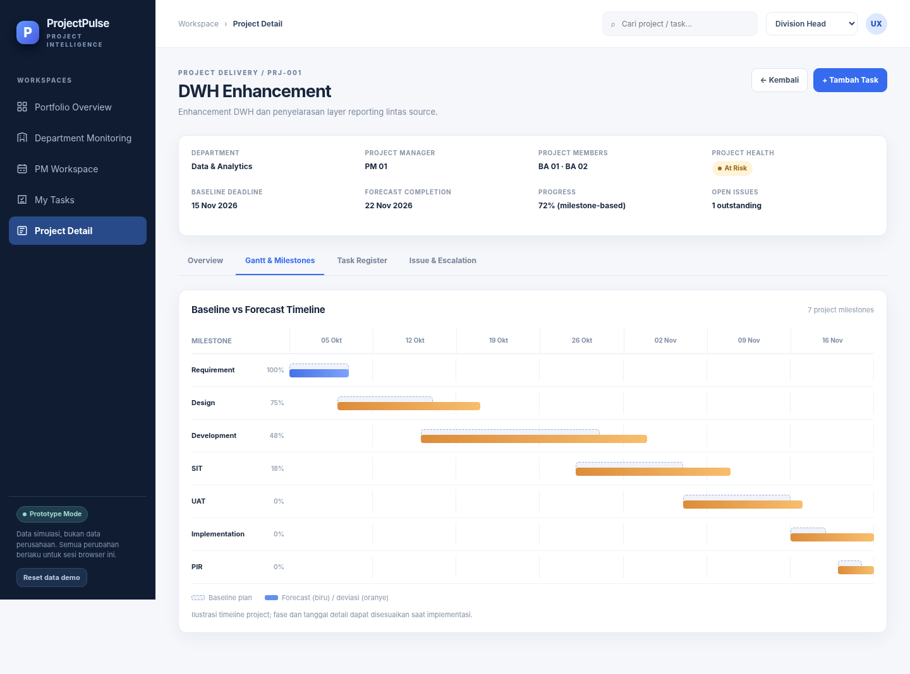
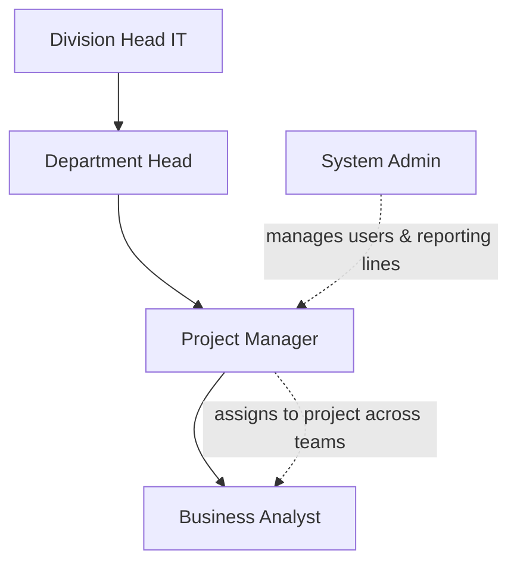
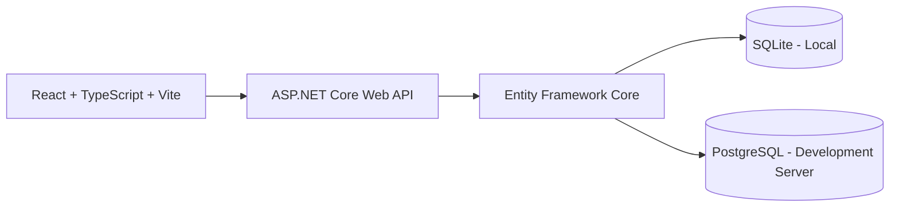

<div align="center">



# ProjectPulse

### One place to manage projects. One clear view for every management level.

**Enterprise Project Portfolio, Resource & Delivery Monitoring**

Pantau proyek dari pekerjaan harian Business Analyst hingga gambaran menyeluruh untuk Division Head — **dalam satu aplikasi, dengan satu sumber data.**


[**Overview**](#-overview) · [**Features**](#-key-features) · [**Screenshots**](#-interface-preview) · [**Tech Stack**](#-technology-stack) · [**Getting Started**](#-getting-started) · [**Roadmap**](#-roadmap)

</div>

---

## 🎯 Overview

**ProjectPulse** adalah aplikasi web internal untuk memantau *project delivery*, kepemilikan pekerjaan, kapasitas resource, milestone, dan kendala di lingkungan divisi IT.

Satu perubahan yang dibuat BA pada task atau timeline dapat menjadi informasi operasional bagi Project Manager, laporan departemen bagi Department Head, dan ringkasan portfolio bagi Division Head.

> **Core principle:** **Update once, monitor at every level.**
>
> Data pekerjaan diperbarui oleh pemilik pekerjaan; pimpinan memantau informasi yang sama sesuai hak aksesnya.

### Masalah yang ingin diselesaikan

- Status proyek tersebar di banyak file atau laporan manual.
- Progress terlihat bagus secara persentase, padahal milestone atau issue kritis tertahan.
- Atasan sulit melihat proyek yang terlambat dan siapa yang bertanggung jawab atas tindak lanjutnya.
- BA dari satu tim dapat membantu proyek tim lain, namun informasi kepemilikan resource sering rancu.
- Timeline, fase berjalan, requester Head Office, dan kendala tidak tersedia dalam satu tampilan.

## ✨ Key Features

| Modul | Kemampuan |
|:--|:--|
| **Executive Portfolio** | Ringkasan project health, distribusi current phase, delivery calendar, daftar proyek dan drill-down per lingkup jabatan. |
| **Project Management** | PM membuat project, memilih BA penanggung jawab timeline, dan menambahkan anggota project. |
| **BA Timeline Ownership** | BA yang ditunjuk mengelola milestone, tanggal planned/forecast, progress, current status, dan project health. |
| **My Tasks** | BA membuat dan memperbarui task miliknya, priority, due date, status, dan catatan aktivitas. |
| **Issue & Escalation** | Registrasi blocker, severity, action plan, status penyelesaian, dan penanggung jawab. |
| **Resource Borrowing** | BA dapat memiliki atasan PM A tetapi menjadi member project yang dipimpin PM B. |
| **Admin & Organization** | Tambah/edit/nonaktifkan user; atur department, role, dan *home reporting PM* tanpa menghapus assignment project. |
| **Requester Head Office** | Simpan nama dan departemen user HO sebagai informasi project, tanpa memberikan akses aplikasi. |
| **REQ ID** | Kode proyek unik berformat `REQYYYYMMDDNNN`, misalnya `REQ20261010001`. |
| **Audit & Activity** | Rekam perubahan kegiatan dan perkembangan task/project untuk kebutuhan penelusuran. |

### Project health ≠ current status

ProjectPulse membedakan **kondisi** proyek dari **fase** pengerjaan proyek:

| Health | Current Status |
|:--|:--|
| `On Track` | `Requirement` |
| `At Risk` | `Design` |
| `Delayed` | `Development` |
| `Blocked` | `SIT`, `UAT`, `Implementation`, `PIR`, dll. |

Contoh: **Development · Blocked** berarti proyek masih pada fase development dan sedang mengalami hambatan. Keduanya ditampilkan berdampingan agar pembaca laporan tidak salah menyimpulkan.

## 🖥️ Interface Preview

**Executive dashboard — portfolio health, delivery pipeline & delivery calendar**



<details>
<summary><b>📌 Lihat BA Workspace</b></summary>
<br />



</details>

<details>
<summary><b>📅 Lihat Project Timeline</b></summary>
<br />



</details>

> **Preview:** menggunakan data dummy. Visualisasi Gantt pada MVP masih sederhana; workflow persetujuan baseline formal belum tersedia.

## 🏢 Roles & Access



| Role | Fokus penggunaan |
|:--|:--|
| **Admin** | Mengelola user, role, department, reporting PM, dan penanggung jawab timeline. |
| **Division Head** | Helicopter view seluruh project dalam lingkup divisinya. |
| **Department Head** | Memantau project, risiko, dan delivery departemennya. |
| **Project Manager** | Membuat project, menunjuk BA, melakukan resource assignment dan monitoring; **tidak mengubah progress/timeline BA**. |
| **Business Analyst** | Mengerjakan task, mengelola issue, serta mengelola milestone/timeline jika menjadi *timeline owner*. |

**Resource borrowing:** home team BA dan keanggotaan project adalah dua hal berbeda. Perubahan atasan PM tidak otomatis memindahkan atau menghapus assignment project yang sudah ada.

## 🛠️ Technology Stack

Versi di bawah diambil dari file `frontend/package.json` dan `backend/ProjectPulse.Api.csproj` pada **source v0.4**. Untuk dependency npm, simbol `^` adalah rentang versi yang diizinkan, **bukan jaminan versi persis yang terpasang**.

| Layer | Technology | Version in source |
|:--|:--|:--|
| Frontend | React / React DOM | `^19.1.1` |
| Frontend language | TypeScript | `^5.9.2` |
| Build & dev server | Vite | `^7.1.0` |
| React Vite plugin | @vitejs/plugin-react | `^5.0.0` |
| Backend | ASP.NET Core / .NET | `net10.0` |
| ORM — SQLite | Microsoft.EntityFrameworkCore.Sqlite | `10.0.3` |
| ORM — PostgreSQL | Npgsql.EntityFrameworkCore.PostgreSQL | `10.0.3` |
| Authentication library | Microsoft.AspNetCore.Authentication.JwtBearer | `10.0.3` |
| Local database | SQLite | Embedded file database |
| Development server database | PostgreSQL | Provider supported; DB setup required |
| UI / charts | CSS + React components | Custom UI, no MUI/ECharts dependency in current source |

**Version note:** paket source ini adalah **ProjectPulse v0.4**, tetapi field `version` di `frontend/package.json` masih `0.3.0` (metadata package yang belum dinaikkan).

**Database strategy:** SQLite untuk pengembangan lokal; PostgreSQL untuk development server. API memilih provider melalui konfigurasi EF Core. Peralihan provider **tidak otomatis memigrasikan data** dari SQLite ke PostgreSQL.

## 🧭 How It Works



**Typical workflow**

1. **PM** membuat project dan memilih BA sebagai *timeline owner*.
2. **BA** mendefinisikan milestone (Requirement → Design → Development → SIT → UAT → Implementation → PIR) dan memperbarui timeline/progress.
3. **BA member** mengelola task serta melaporkan kendala.
4. **PM** memonitor pelaksanaan dan menambahkan resource lintas tim bila diperlukan.
5. **Department Head** dan **Division Head** melihat ringkasan proyek sesuai otorisasi, lalu membuka detail saat ada risiko.

## 📂 Project Structure

```text
ProjectPulse/
├── backend/                      # ASP.NET Core Web API (.NET 10)
│   ├── Program.cs                # Bootstrap, routes, API, authentication
│   ├── AppDbContext.cs           # EF Core data access
│   ├── Models.cs                 # Entity & request/response models
│   ├── SeedData.cs               # Dummy users, projects, tasks & issues
│   ├── LocalAuth.cs              # Authentication untuk local demo
│   ├── LocalUpgrade.cs           # Upgrade struktur SQLite lokal
│   ├── ProjectPulse.Api.csproj   # Target framework & NuGet packages
│   └── appsettings.json          # Konfigurasi provider & security
├── frontend/                     # React + TypeScript + Vite
│   ├── public/branding/          # Logo SVG/PNG dan favicon ICO
│   ├── src/
│   │   ├── App.tsx               # Halaman dan komponen utama
│   │   ├── api.ts                # API client & auth helpers
│   │   ├── main.tsx              # Entry point React
│   │   └── style.css             # Custom design system
│   ├── package.json              # Frontend dependencies & scripts
│   └── vite.config.ts            # Vite dev server & /api proxy
├── sql/                          # PostgreSQL schema & upgrade scripts
├── docs/                         # API, ERD, changelog & UI/UX blueprint
├── previews/                     # Screenshot UI untuk README
├── prototype/                    # Prototype HTML standalone
├── tests/                        # Script pengecekan struktur
├── docker-compose.postgres.yml   # Opsi database PostgreSQL
├── CARA_JALANKAN_LOCAL.txt       # Catatan personal cara menjalankan
└── README.md                     # Dokumentasi project di GitHub
```

## 🚀 Getting Started

**Prerequisites:** Windows / PowerShell, **.NET SDK 10**, **Node.js 22.12+**, dan npm.

**1. Start backend** (terminal pertama):

```powershell
cd C:\work\ProjectPulse\backend
$env:ASPNETCORE_ENVIRONMENT = "Development"
$env:ASPNETCORE_URLS = "http://127.0.0.1:5088"
dotnet restore
dotnet run --no-launch-profile
```

**2. Start frontend** (terminal kedua):

```powershell
cd C:\work\ProjectPulse\frontend
npm.cmd install
npm.cmd run dev
```

**3. Open the application:** http://127.0.0.1:5173

- Backend health endpoint: http://127.0.0.1:5088/api/health
- Local SQLite file: `backend/Data/projectpulse.db` (dibuat saat startup pertama)
- Demo akun tersedia pada local login page; password default untuk akun dummy dicatat pada `CARA_JALANKAN_LOCAL.txt`.
- Perintah `npm.cmd` dipakai untuk menghindari pembatasan eksekusi `npm.ps1` di PowerShell Windows.

Untuk langkah detail, troubleshooting, backup/reset database, dan workflow Git, lihat **[CARA_JALANKAN_LOCAL.txt](CARA_JALANKAN_LOCAL.txt)**.

## 🔐 Security & Important Notes

> [!WARNING]
> **MVP / local demo only. Not production-ready.**
>
> - Password demo di database disimpan sebagai **salted PBKDF2 hash**, bukan reversible encryption atau teks biasa.
> - Reset password tanpa verifikasi identitas hanya untuk demo lokal; jangan mengekspos mode ini ke jaringan publik/perusahaan.
> - Provider PostgreSQL dan mode JWT sudah disiapkan, tetapi integrasi frontend Microsoft Entra ID / MSAL untuk deployment belum selesai.
> - File database, credentials, API keys, dan konfigurasi rahasia tidak boleh dimasukkan ke repository.
> - End-to-end build dan deployment penuh **belum tervalidasi** pada lingkungan pembuatan source; lakukan pengujian lokal terlebih dahulu.

## 🗺️ Roadmap

- [x] UI dashboard menurut role (BA, PM, Department Head, Division Head)
- [x] Admin dan user management untuk data demo
- [x] Multi-BA assignment & resource borrowing
- [x] REQ ID, internal HO requester, current project status
- [x] BA-managed milestone, timeline, task, issue, progress
- [x] Ringkasan chart untuk helicopter view
- [x] SQLite lokal & provider PostgreSQL di backend
- [ ] Uji build dan seluruh user journey end-to-end di Windows
- [ ] Implementasi lengkap Microsoft Entra ID / SSO pada frontend dan deployment
- [ ] Database migrations formal serta deployment PostgreSQL development
- [ ] Automated tests, security review, dan CI/CD
- [ ] Baseline approval, notifikasi, dan workload/capacity analytics lanjutan

## 📚 Documentation

- [`docs/ERD.md`](docs/ERD.md) — Entity relationships dan model data
- [`docs/API.md`](docs/API.md) — Dokumentasi API (sebagian kontrak historis; lihat changelog untuk pembaruan v0.4)
- [`docs/CHANGELOG_v0.4.md`](docs/CHANGELOG_v0.4.md) — Fitur terbaru, access matrix & known limitations
- [`docs/UI_UX_BLUEPRINT.md`](docs/UI_UX_BLUEPRINT.md) — Rancangan UI/UX
- [`CARA_JALANKAN_LOCAL.txt`](CARA_JALANKAN_LOCAL.txt) — Catatan praktis untuk menjalankan project

---

<div align="center">

**ProjectPulse** — *From daily tasks to strategic visibility.*

<sub>Internal project monitoring MVP · Demo dataset · Version 0.4</sub>

</div>
