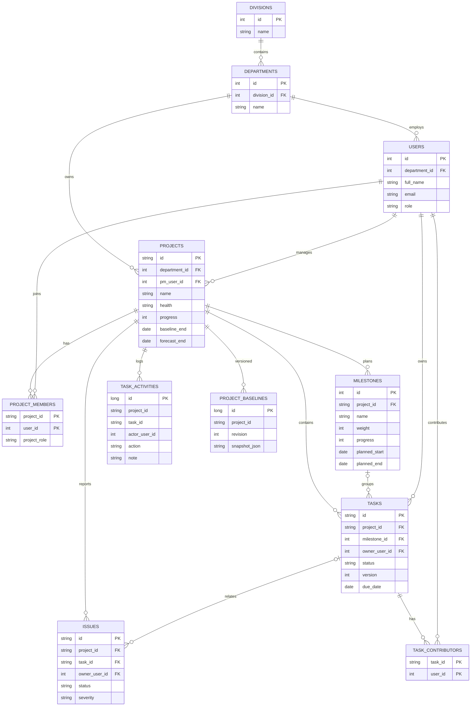

# ERD — ProjectPulse MVP v0.2

## Keputusan penting

- **Database local:** SQLite file; **server DEV:** PostgreSQL dengan schema `snake_case`.
- `Division > Department > Project > Milestone > Task`; 1 project memiliki PM accountable, member BA banyak.
- `project_members`: PK komposit `(project_id, user_id)` memungkinkan BA ikut beberapa project.
- `task_contributors`: PK komposit `(task_id, user_id)`. Setiap task tetap punya satu primary owner.
- `health` tidak dikalkulasi langsung dari status task. PM mengubah dengan reason dan dicatat sebagai activity.
- `progress`: agregasi milestone yang telah di-update PM dan hanya valid bila total weight milestone = 100.
- `version`: optimistic concurrency task untuk mendeteksi update bersamaan.
- `project_baselines` disiapkan untuk desain history, **belum ada approval lifecycle**.
- Prototype head scope satu divisi/departemen berdasarkan pengaturan user; multi-role/cross-department sharing menjadi perluasan desain.

## Catatan data governance

Hindari mengimpor data project sungguhan ke SQLite demo saat engine masih memakai identity fiktif. SSO, hardening authorization, backup, attachment policy, dan data retention wajib sebelum digunakan lintas departemen.

## Authentication local demo (v0.3)

- `users.password_hash`: salted PBKDF2-HMAC-SHA256 hash, string; tidak dapat didekripsi.
- `local_sessions`: `id`, `user_id`, `token_hash` (SHA256), `expires_at`, `created_at`. Dipakai hanya oleh SQLite local development. PostgreSQL memakai JWT/Entra; tabel ada untuk parity skema tetapi tidak digunakan untuk menyimpan sesi login.
- Hierarki contoh: IT Division → Department Project → peran PM → peran BA. Role adalah atribut user, bukan layer departemen.

## v0.4 extensions
- `users.reports_to_pm_user_id` (nullable FK to `users.id`): BA's **home team**; does not imply ownership of assigned projects.
- `users.is_active` (boolean): inactive users cannot log in.
- `project_members(project_id,user_id)` implements **many-to-many resource borrowing**; existing assignments survive a BA home-team transfer.
- `projects.id`: unique `REQYYYYMMDDNNN` primary key, all subordinate tables use same id.
- `projects.timeline_owner_user_id`: BA who edits milestones, dates and health (must be an assigned active BA).
- `projects.requester_name`,`requester_department`: Head Office requester *metadata only*, not an AppUser.
- `projects.current_status`: delivery phase, independent of Health.
- `req_counters(date_key PK,last_number)`: per-WIB-day ID allocator; separate from internal task ID.
